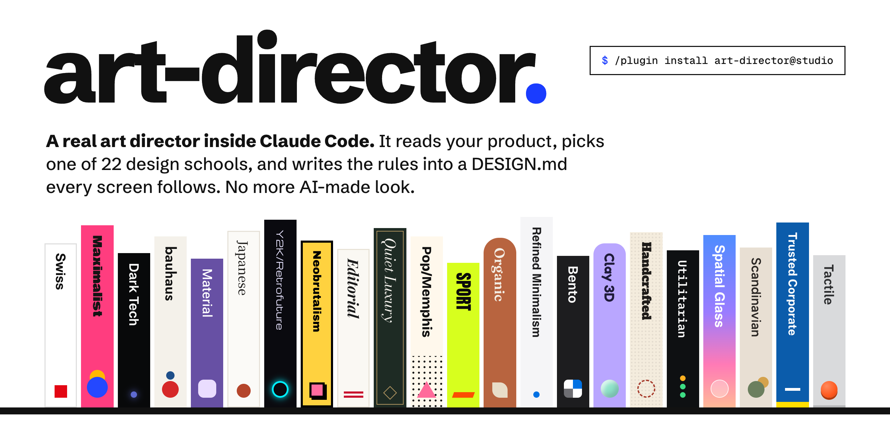
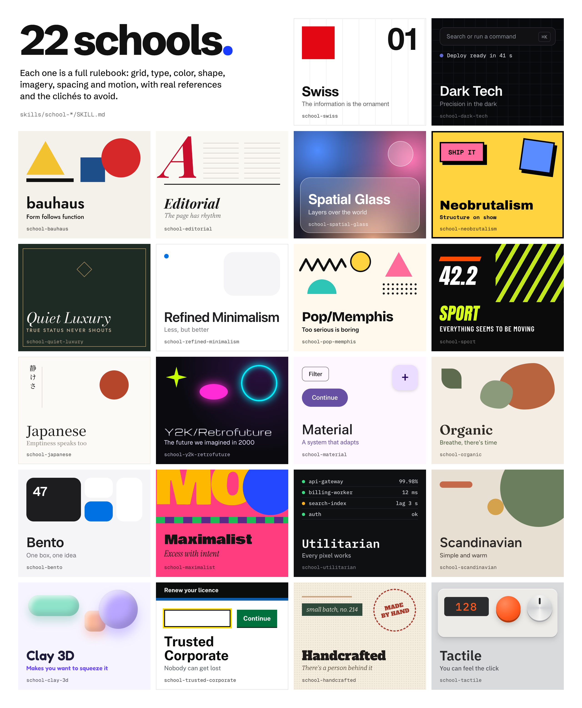
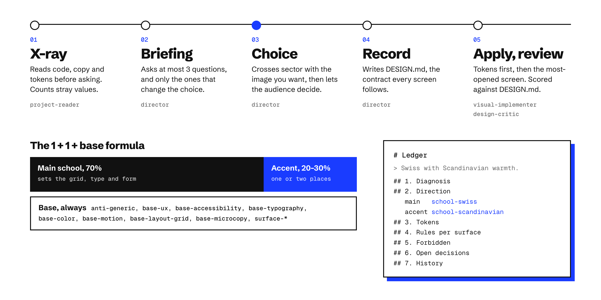

<p align="center">
  
</p>

<p align="center">
  <a href="LICENSE"></a>
  
  
  
</p>

**Claude writes good code and ships the same screen every time.** Purple gradient, three identical cards, raw Inter, a fade-up on every scroll. art-director gives Claude Code the judgment of a working art director. It reads your product, picks the one design school that fits your audience, and writes the rules into a `DESIGN.md` that every later screen has to follow.

The sector suggests, the audience decides, the school follows. No trend glued onto any product.

## Install

```bash
/plugin marketplace add robertoDon/studio
/plugin install art-director@studio
```

Pick the **user** scope to have it in every project. Then ask for a direction:

```bash
/art-director:direction trustworthy, but not boring
```

Or just say it in your own words: "give this app a look", "make it feel premium", "review this landing page". The skills and agents step in on their own, and the agents reply in your language.

## 22 schools, not 22 themes

<p align="center">
  
</p>

A theme changes colors. A school is a full rulebook. Each `school-*` skill covers when to use it and when not to, the rules in numbers (grid, type scale, color, shape, imagery, spacing, motion), rules per surface, starter tokens, real references to study, what makes it look generic, what it pairs with and what it clashes with, and a checklist.

## How it works

<p align="center">
  
</p>

1. **X-ray.** Reads the code, copy and tokens before asking anything, and counts the stray values.
2. **Briefing.** At most 3 questions, and only the ones that change the choice.
3. **Choice.** Crosses the sector with the image you want, then lets the audience decide. One main school (about 70%), one accent (20–30%, in one or two places), and the base, always. Already have a look? It names it and tightens it instead of starting over.
4. **Record.** Writes `DESIGN.md`: diagnosis, direction, tokens, rules per surface, forbidden list, open decisions and history.
5. **Apply and review.** Tokens first, then the most-opened screen, in small slices with before and after in numbers. Then a critic scores the result against `DESIGN.md`.

## What it refuses

The `anti-generic` skill lists the patterns that give a screen away as AI-made or templated. The plugin checks every screen against it.

- Purple-to-blue gradient on white, over three identical feature cards
- Cream background, big serif, terracotta button
- Near-black with acid green
- Raw Inter on untouched shadcn
- Small-caps labels above every heading
- Dots between words, an arrow on every button
- Fade-up on every scroll, phones floating in perspective

A pattern your house chose on purpose (your brand purple, your Inter) is not flagged.

And the rules it never breaks:

- **Your house rules win.** If the project has a `DESIGN.md`, a style guide or its own finish skill, the school fits inside it.
- **Accessibility is not a style.** Text contrast of 4.5:1 or more, and no state shown by color alone.
- **Motion has a ceiling.** Touch up to 160 ms, reveal up to 700 ms, a scene up to 1.2 s including delays. A stricter project rule wins.
- **Every choice has a reason.** Audience, sector or image. Never "it's trending".

## Commands

| Command | What it does |
|---|---|
| `/art-director:direction [the image you want]` | X-ray, up to 3 questions, then the direction (main school, accent, base) with the why. Writes `DESIGN.md` after your ok. |
| `/art-director:apply [screen]` | Applies `DESIGN.md` to the code in slices, tokens first, with before and after in numbers. |
| `/art-director:audit [screen]` | Review with severity 0–4 against `DESIGN.md`, the school, WCAG 2.2, the heuristics and the anti-generic list. |
| `/art-director:schools [context]` | The catalog, or the 3 candidate schools for a context ("recipe app for families"). |

## Agents

| Agent | Role |
|---|---|
| `director` | The consultant. Diagnosis, choice and `DESIGN.md`. Never touches code without your ok. |
| `project-reader` | Read-only X-ray: product, likely audience, stack, tokens with a count of stray values, existing house rules. |
| `visual-implementer` | Implements the direction in small slices and checks it: build, screenshots at 375 and 1440 px. |
| `design-critic` | Reviews and measures. Returns findings with severity and a concrete fix. Read-only. |

## Skills

**Method.** `art-direction` (briefing, the sector × image × audience matrix, the `DESIGN.md` format), `anti-generic`, `logo-design` (production-ready logo variants).

**22 schools.**

| Mood | Schools |
|---|---|
| Order and clarity | `school-swiss` `school-refined-minimalism` `school-trusted-corporate` `school-utilitarian` `school-material` |
| Tech and depth | `school-dark-tech` `school-spatial-glass` `school-bento` `school-tactile` |
| Reading and status | `school-editorial` `school-quiet-luxury` `school-japanese` |
| Warmth and nature | `school-scandinavian` `school-organic` `school-handcrafted` |
| Energy and play | `school-pop-memphis` `school-sport` `school-clay-3d` `school-maximalist` `school-y2k-retrofuture` |
| Form and structure | `school-bauhaus` `school-neobrutalism` |

**UX/UI base.** `base-ux` (laws of UX, Gestalt, Nielsen's heuristics), `base-accessibility` (WCAG 2.2 AA), `base-typography`, `base-color`, `base-motion` (with microinteractions, sound and haptics), `base-layout-grid`, `base-tokens`, `base-microcopy`.

**Surfaces.** `surface-landing-page`, `surface-web-app`, `surface-mobile-app`, `surface-website`, `surface-ecommerce`, `surface-slides`.

**Trends.** `trends` (a catalog with evidence levels) and 7 skills: `trend-typography`, `trend-vivid-color`, `trend-3d-webgl`, `trend-cinematic-scroll`, `trend-dashboards`, `trend-playful-illustration`, `trend-collage`. A trend comes in as an accent, almost never as the main school. Trends age; schools don't.

## Turn it on for a whole team

Put this in the project's `.claude/settings.json`. Anyone who opens the project gets the plugin.

```json
{
  "extraKnownMarketplaces": {
    "studio": {
      "source": { "source": "github", "repo": "robertoDon/studio" }
    }
  },
  "enabledPlugins": {
    "art-director@studio": true
  }
}
```

To update when a new version ships:

```bash
/plugin marketplace update studio
```

## Limits

- **It directs, it doesn't draw.** No image generation. Photos, illustrations and 3D come from you or your other tools.
- **Apply works best on tokens.** Projects with CSS variables or Tailwind get the cleanest slices. Hard-coded values everywhere means more slices.
- **The trend catalog is a snapshot.** It was read from Muzli on 18 Nov 2026 and will age. The schools won't.
- **Some examples are Brazilian on purpose.** Pix, boleto, installments, gov.br and pt-BR number formats show up where a local example teaches more than a generic one.

## Upgrading from 0.x

Version 1.0 moved everything to English, names included.

| Before | Now |
|---|---|
| `/art-director:direcao`, `aplicar`, `auditar`, `escolas` | `/art-director:direction`, `apply`, `audit`, `schools` |
| `diretor-de-arte`, `leitor-de-projeto`, `aplicador-visual`, `critico-de-design` | `director`, `project-reader`, `visual-implementer`, `design-critic` |
| `escola-*`, `superficie-*`, `tendencia-*` | `school-*`, `surface-*`, `trend-*` |
| `direcao-de-arte`, `anti-generico`, `base-acessibilidade`, ... | `art-direction`, `anti-generic`, `base-accessibility`, ... |

Run `/plugin marketplace update studio`. An existing `DESIGN.md` that names old slugs still reads fine; rename them when you next touch it.

## Sources

- **Schools.** Graphic design history and public design systems: Müller-Brockmann, Dieter Rams, Material Design, Apple HIG, GOV.UK, IBM Carbon and more, cited inside each skill.
- **Base.** Nielsen Norman Group, WCAG 2.2, *Laws of UX* (Jon Yablonski), Baymard Institute, Bringhurst.
- **Trends.** The Muzli blog (muz.li), read on 18 Nov 2026. Per-item sources are in [`trends/references/muzli-2026.md`](plugins/art-director/skills/trends/references/muzli-2026.md).

## About this repo

`studio` is a Claude Code plugin marketplace, and `art-director` is its first plugin. Each skill is a single `SKILL.md` under [`plugins/art-director/skills`](plugins/art-director/skills). The README images are rendered from HTML in [`assets/src`](assets/src) with `sh assets/src/render.sh`.

## License

[MIT](LICENSE)
